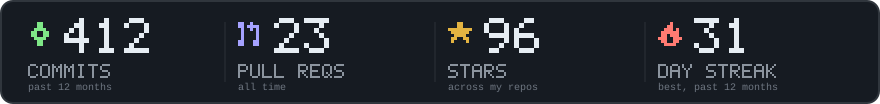
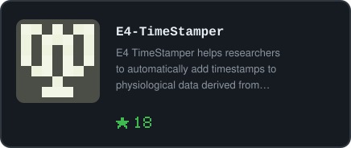
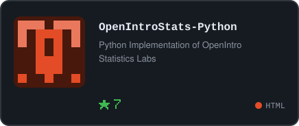
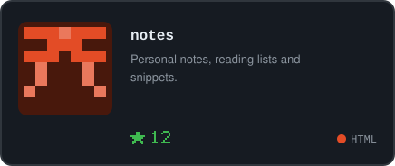
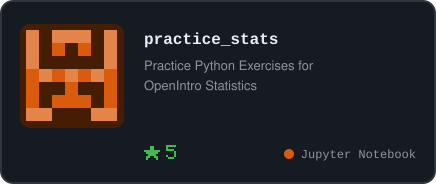

  

👋 Hi, I'm **Imran**!

💼 I'm a Data Scientist & AI Developer with 10+ years across analytics, research, and engineering, from machine learning to LLMs and agentic systems.

🔭 I’m currently building AI pipelines and agents that turn messy data into clear decisions. 

🌱 I’m upskilling in AI. 

😮 Fun fact! I've lived on four continents and in five countries, so far. 

📫 You can reach me by imran at alumni.rutgers.edu

[GitHub](https://github.com/imranture) · [Website](https://www.imranture.com/)

<!-- PROJECTS:START -->

  
  

  
  

<!-- PROJECTS:END -->

